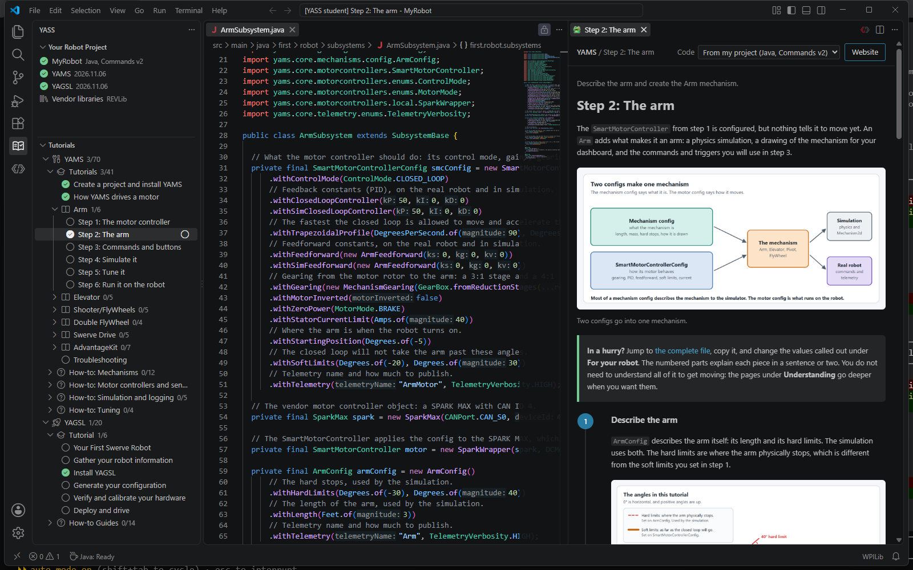
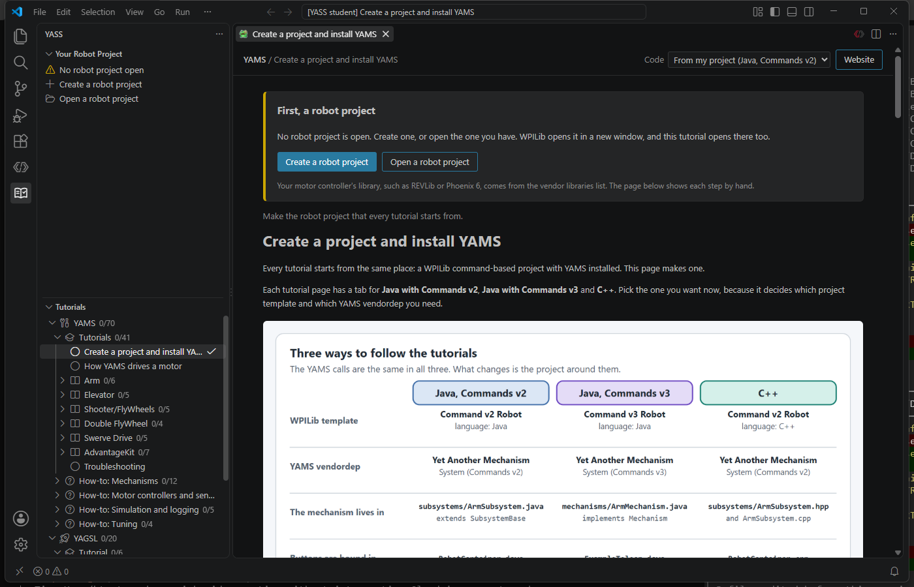
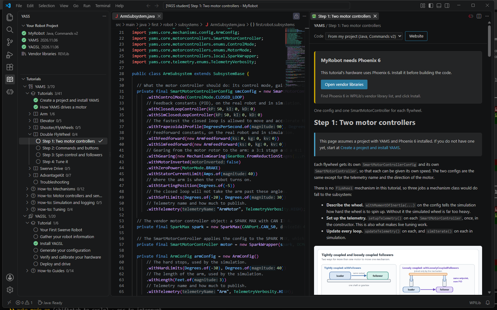
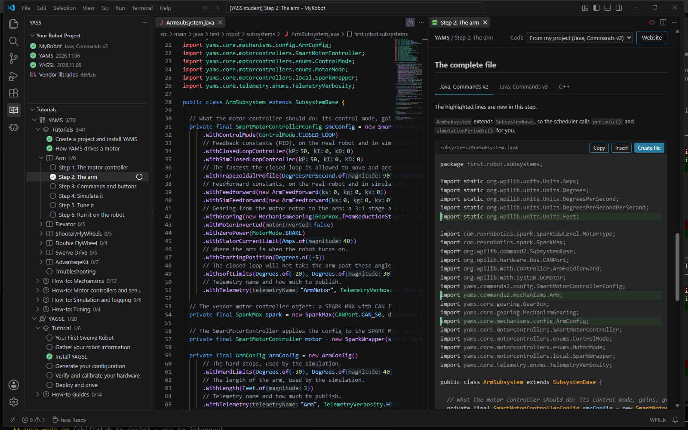
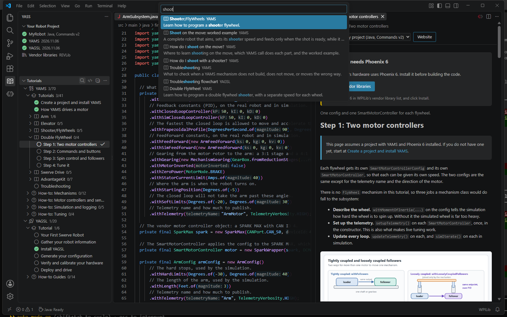
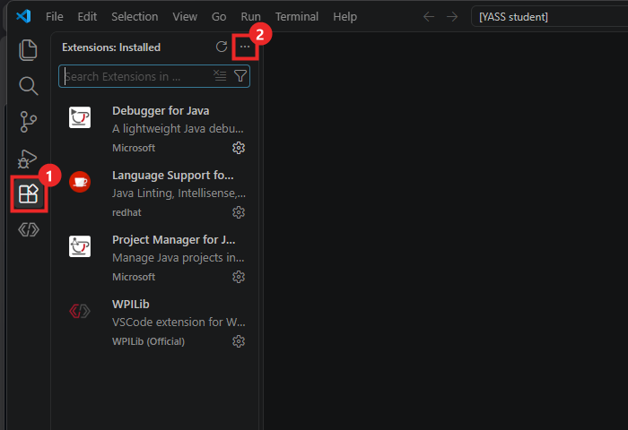
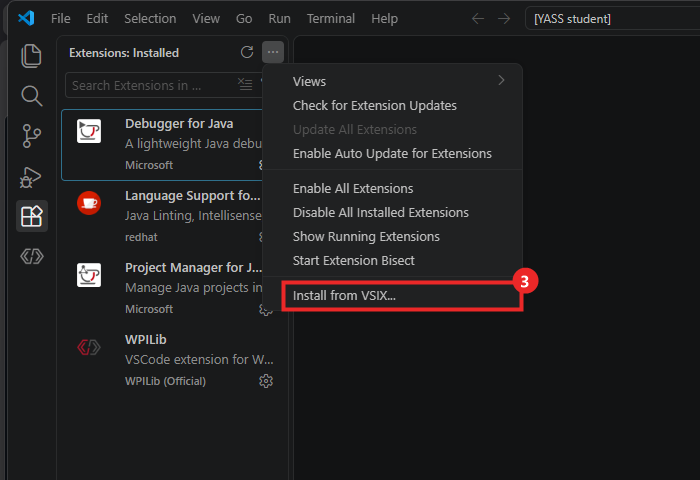
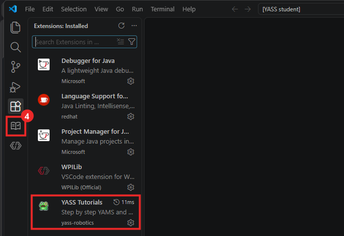

# YASS Tutorials

[](https://github.com/Yet-Another-Software-Suite/yass-tutorials-vscode/releases/download/latest/yass-tutorials.vsix)
[](https://github.com/Yet-Another-Software-Suite/yass-tutorials-vscode/actions/workflows/build.yml)

Learn to program your robot with [YAMS](https://yams.yassrobotics.com) and [YAGSL](https://docs.yagsl.com) without leaving WPILib VS Code.

The extension adds a **YASS** tab to the activity bar, next to the Explorer. It lists the YAMS and YAGSL tutorials and how-to guides step by step, and opens each one beside your code.



## From an empty window to a working project

**Your Robot Project** shows whether a robot project is open and whether it has YAMS and YAGSL. With no project open, a tutorial offers to create one. WPILib opens the new project in its own window, and the tutorial opens there too.



One click installs the YAMS or YAGSL vendordep that matches your project: Commands v2 or Commands v3, Java or C++.

When a tutorial needs a library your project doesn't have yet, such as the REVLib a SparkMax needs or Phoenix 6 for a TalonFX, the page says so and opens WPILib's vendor library list.



## Code you can use straight away

* Every code sample has **Copy** and **Insert**. **Insert** puts the code at the cursor in the file you were last editing.
* A complete file also has **Create file**, which writes it to the right folder of your project and opens it beside the tutorial.
* The lines a step adds are highlighted, the same as in the docs.
* Pick **Java, Commands v2**, **Java, Commands v3** or **C++** once and every sample switches to it. By default the extension picks it from your project.



## Find your way

Mark steps as done to track your progress, and search every tutorial with the magnifying glass. Links to the rest of the docs open the website.



## Install

Download [yass-tutorials.vsix](https://github.com/Yet-Another-Software-Suite/yass-tutorials-vscode/releases/download/latest/yass-tutorials.vsix). CI rebuilds it from the latest YAMS and YAGSL docs on every push and every day. Then, in WPILib VS Code:

1. Click **Extensions** in the activity bar on the left.
2. Click **...** at the top of the Extensions view.



3. Click **Install from VSIX...**, and pick the `yass-tutorials.vsix` you downloaded.



4. **YASS Tutorials** is now in the list of installed extensions. Click the book icon it adds to the activity bar to open the tutorials.



To update, install the new `yass-tutorials.vsix` the same way. From a terminal, `code --install-extension yass-tutorials.vsix` does the same.

## Build

[REFERENCE.md](REFERENCE.md) explains how the extension works and which file does what.

The tutorials come from the YAMS and YAGSL GitBook repos, cloned next to this one as `YAMS-Gitbook` and `YAGSL-gitbook`.

```
npm install
npm run package
```

`npm run build-docs` renders the GitBook pages into `content/`, and `npm run package` also writes `dist/yass-tutorials.vsix`. Pass other repo locations with `node scripts/build-docs.mjs --yams <path> --yagsl <path>`.
